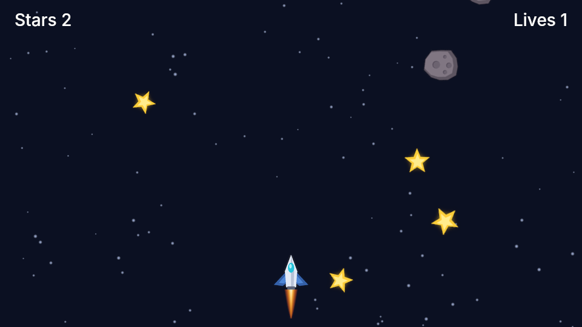
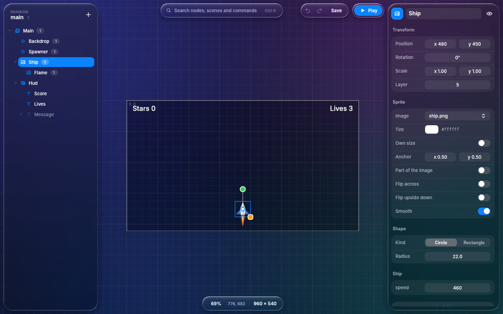

# Brandon

A 2D game engine in Rust that is easy to learn and capable of beautiful graphics. The goal is a more polished alternative to Godot: a simple scene tree, Rust as the only language, a Vulkan renderer and a minimal editor.

**Status: early.** The runtime core works and runs a small demo game, and a first version of the editor can open, change, save and play its scenes. See [DESIGN.md](DESIGN.md) for the plan and the decisions behind it.



## Try it

You need Rust 1.86 or newer and a graphics driver with Vulkan 1.2.

```sh
cargo run -p starfall   # catch the stars, dodge the rocks (A/D or arrows)
cargo run -p hello      # the smallest game: a scene built in code, with a camera
```

## The editor



```sh
cargo run -p brandon_editor -- examples/starfall
```

Give it a game's folder (the one with `Cargo.toml` and `assets`) and, optionally, a scene such as `scenes/main.scene`. It shows three areas and nothing else:

- **Scene tree** on the left. Drag a node to reorder it or move it under another node. Right-click for more, and `+` adds a node.
- **Viewport** in the middle, drawn by the engine's own renderer. Click to select. Drag to move, drag the green handle to rotate and the orange one to scale. Hold Ctrl to snap. Scroll to zoom, drag empty space or use the middle button to pan, and double-click to frame a node. The blue frame is the game's window.
- **Inspector** on the right. It shows only the parts and behaviours the node has, and **+ Add** adds more.

Scenes placed inside other scenes are shown in purple. Their insides are read only here, and **Placed from** opens the scene they come from.

The editor does not load your game's code, so a behaviour's settings are edited as the data in the scene file: numbers, true/false and text get proper fields, and anything else is edited as text. Saving keeps files readable and keeps the comment lines at the top of a file, but other comments in it are lost.

| Keys | Does |
| --- | --- |
| Ctrl+K | Search nodes, scenes and commands |
| Ctrl+S | Save |
| Ctrl+Z, Ctrl+Shift+Z | Undo, redo |
| F5 | Play the game (saves first, then `cargo run`), or stop it |
| Ctrl+D, Delete | Duplicate, delete |
| F, Home | Frame the selection, frame everything |
| Arrow keys | Nudge by one pixel, or ten with Shift |
| Esc | Clear the selection |

## A first game

```rust
use brandon::prelude::*;

/// Moves its node with the keyboard.
struct Player {
    speed: f32,
}

impl Behaviour for Player {
    fn update(&mut self, node: &mut Node, ctx: &mut Ctx) {
        let direction = ctx.input.axis2d(Key::A, Key::D, Key::W, Key::S);
        node.transform.position += direction * self.speed * ctx.dt();
    }
}

fn main() {
    Game::new()
        .title("My game")
        .setup(|scene| {
            scene.spawn(
                Node::new("Player")
                    .at(640.0, 360.0)
                    .with(Sprite::rect(48.0, 48.0, Color::hex(0xffb000)))
                    .with(Player { speed: 300.0 }),
            );
        })
        .run();
}
```

## How a game is put together

- A game is a tree of **nodes**. A node has a name, a transform and children, and nothing else.
- **Parts** make a node do built-in things. There is a short, flat list and a node has at most one of each: `Sprite`, `Text`, `Camera`, `Shape` (overlap detection) and `Overlay` (drawn fixed to the window, for scores and menus).
- **Behaviours** are your own Rust types. They get `ready` once and `update` every frame.
- **Scenes** are readable text files. One scene can be placed inside another, and spawned at runtime with `ctx.instantiate("scenes/rock.scene")`.

A scene file looks like this:

```ron
(
    name: "Ship",
    transform: (position: (480, 450)),
    sprite: (texture: "ship.png"),
    shape: Circle(radius: 22),
    behaviours: {
        "Ship": (speed: 460),
    },
    children: [
        (name: "Flame", transform: (position: (0, 28)), sprite: (texture: "flame.png")),
    ],
)
```

A behaviour that appears in scene files is marked with `#[behaviour]` and registered once:

```rust
#[behaviour]
#[derive(Default)]
struct Ship {
    speed: f32,
}

Game::new().register::<Ship>().start_scene("scenes/main.scene").run();
```

Coordinates: `x` grows to the right and `y` grows downwards. One unit is one pixel at normal zoom. Without a camera, `(0, 0)` is the top-left corner of the window.

## What works today

- Window, game loop, keyboard and mouse input
- Vulkan renderer: sprites batched by texture, tinting, draw order, smooth or pixel-art scaling
- Text with a built-in font, sharp at any zoom
- Camera with zoom and rotation, plus overlays fixed to the window
- Scene tree with parts and behaviours, spawning and removing nodes while the game runs
- Scene files, scenes inside scenes, and clear messages for mistakes in them
- Overlap detection between circles and (rotated) rectangles
- Missing images show a bright checkerboard instead of crashing the game

- The editor: scene tree, inspector, viewport handles, undo, search and Play

Not yet: hot reload of game code, physics, audio, lighting and custom shaders, animation, typed node references and events.

## Workspace

| Crate | What it holds |
| --- | --- |
| `brandon` | What games depend on: `Game`, the game loop and the prelude |
| `brandon_core` | Maths, colour, time, input, random numbers, asset lookup |
| `brandon_scene` | Nodes, parts, behaviours, scene files |
| `brandon_render` | The Vulkan renderer and text |
| `brandon_macros` | `#[behaviour]` and `#[data]` |
| `brandon_editor` | The editor app |

## Developing

```sh
cargo test --workspace
cargo clippy --workspace --all-targets
```

Two environment variables help when checking the renderer:

- `BRANDON_VALIDATION=1` turns on the Vulkan validation layers, if they are installed.
- `BRANDON_CAPTURE=out.png` saves one frame as a PNG and quits. `BRANDON_CAPTURE_FRAME=120` picks which frame. While capturing, time advances by exactly 1/60 s per frame and random numbers are seeded, so the picture is the same every run. The editor accepts it too.

So far the engine has only been run on Linux, with Mesa's software Vulkan driver (lavapipe). Windows and macOS (through MoltenVK) are written for but untested.

## License

GPL-3.0. The built-in font is Inter, under the SIL Open Font License (see `crates/brandon_render/assets/Inter-LICENSE.txt`). The editor also uses Inter SemiBold, under the same license (see `crates/brandon_editor/assets/Inter-LICENSE.txt`).
